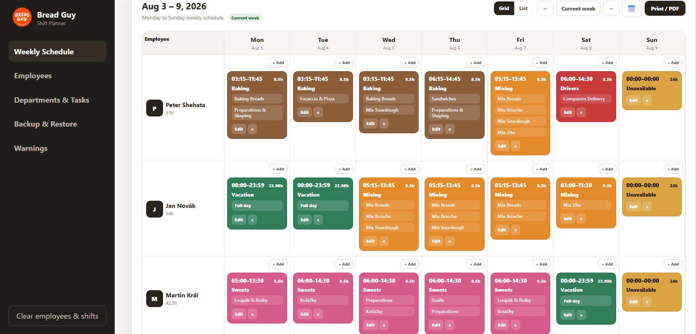
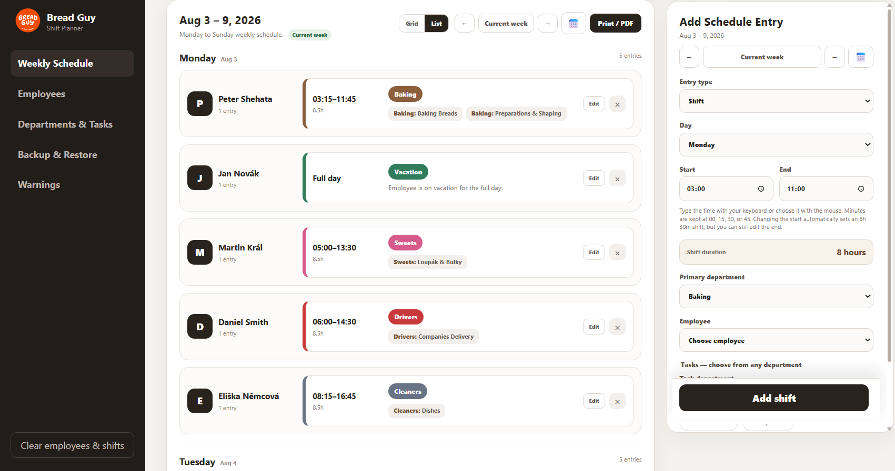
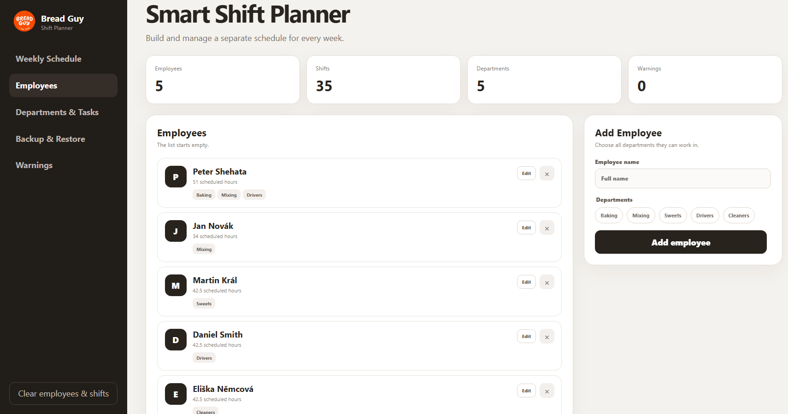
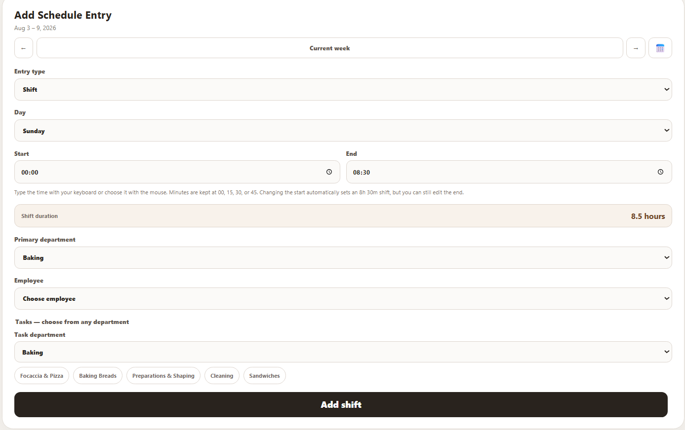
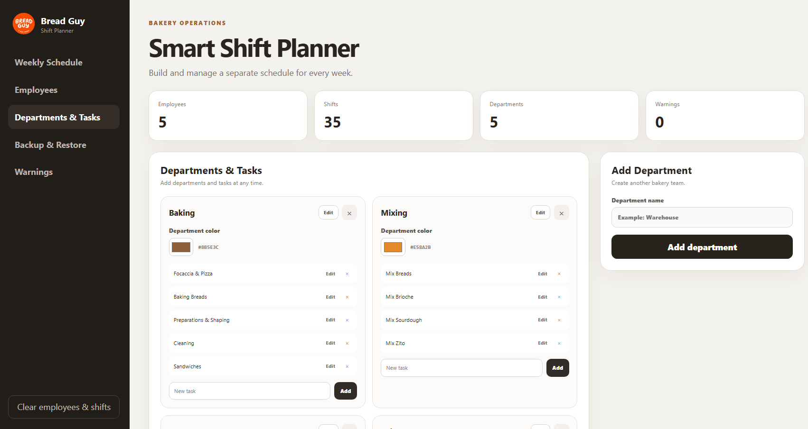
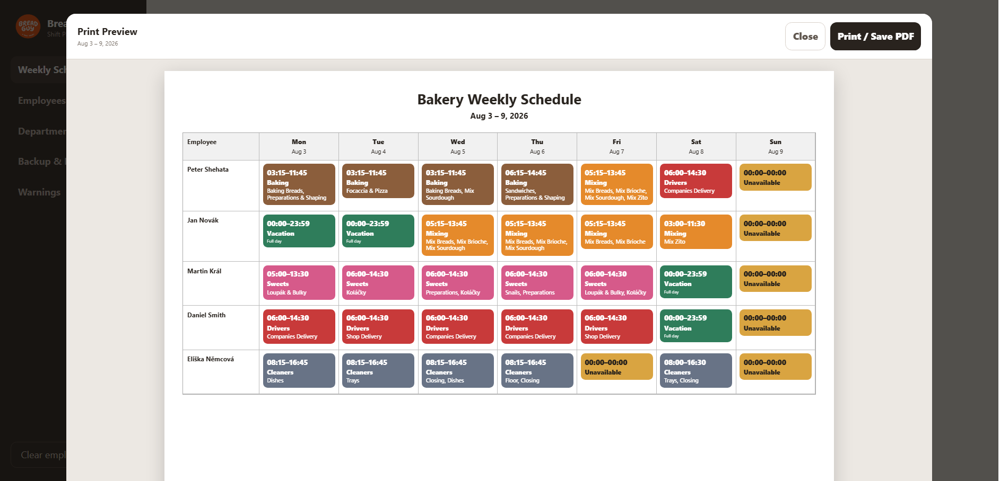
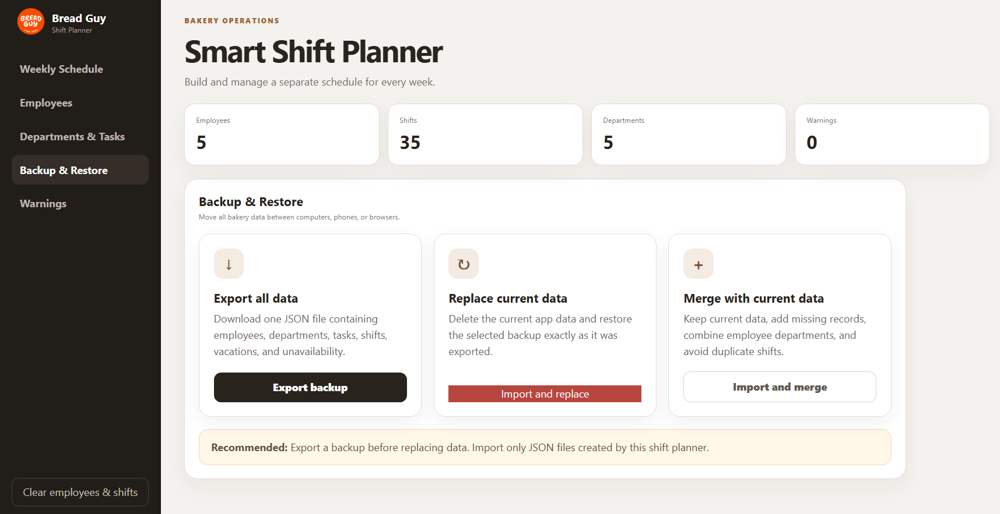

# Bread Guy Shift Planner

A responsive weekly shift-planning application built with React and Vite.

The application was created to simplify employee scheduling for a bakery. It allows managers to organize employees, departments, tasks, working shifts, vacations, and unavailability in one place.

## Project Overview

The Bread Guy Shift Planner helps manage weekly bakery operations through a clear visual schedule.

The project was designed around a real workplace need and includes tools for creating schedules, checking conflicts, printing weekly plans, and backing up browser data.

## Screenshots

### Weekly Schedule — Grid View



### Weekly Schedule — List View



### Employees Management



### Add or Edit a Shift



### Departments and Tasks



### Print and PDF Preview



### Backup and Restore



## Main Features

- Weekly schedule from Monday to Sunday
- Grid and list schedule views
- Add, edit, and delete employees
- Assign employees to multiple departments
- Create and manage departments and tasks
- Add normal shifts, vacations, and unavailability
- Select tasks from multiple departments
- Automatic shift-duration calculation
- Automatic default shift end time
- Employee working-hours calculation
- Overlapping-shift warnings
- Custom colors for each department
- Print preview and PDF export
- Compact task display for printing
- Local browser storage
- Export all data as a JSON backup
- Import and replace existing data
- Import and merge data without duplicating shifts
- Responsive interface for different screen sizes

## Technologies Used

- React
- JavaScript
- Vite
- HTML5
- CSS3
- Local Storage
- Git
- GitHub

## How the Data Is Stored

The application currently stores data in the browser using `localStorage`.

The following data is stored locally:

- Employees
- Departments
- Tasks
- Shifts
- Vacations
- Unavailability

The Backup and Restore page allows the user to export this information as a JSON file and import it on another device or browser.

## Installation

Clone the repository:

```bash
git clone https://github.com/petershehata10/Shift-Planner