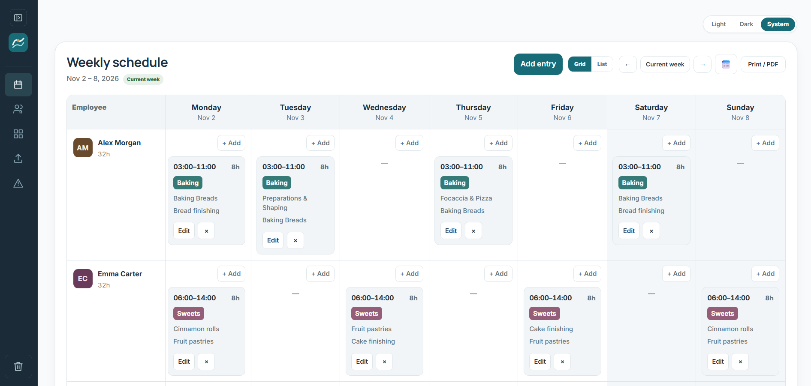
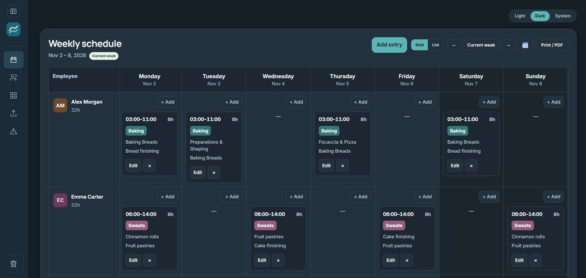
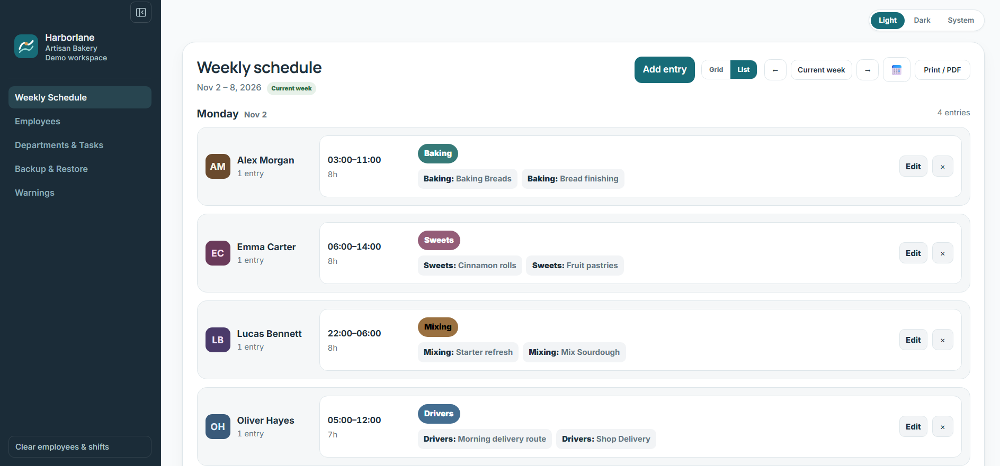
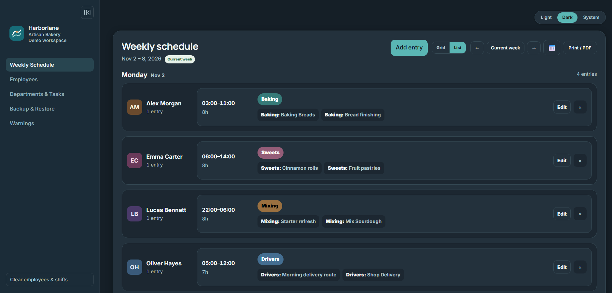
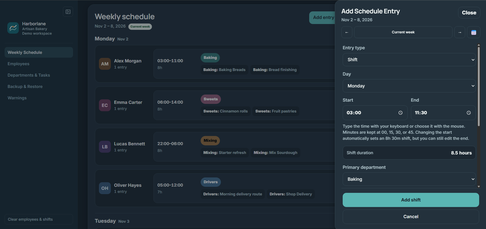
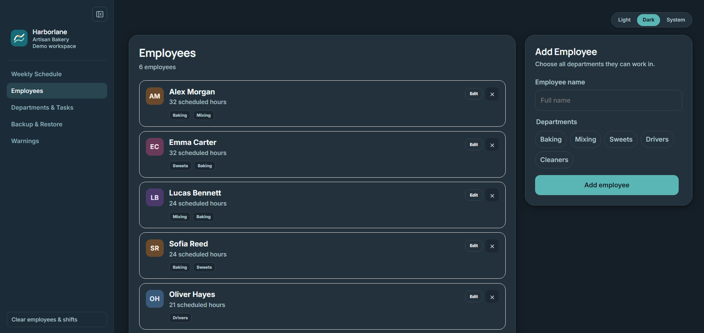
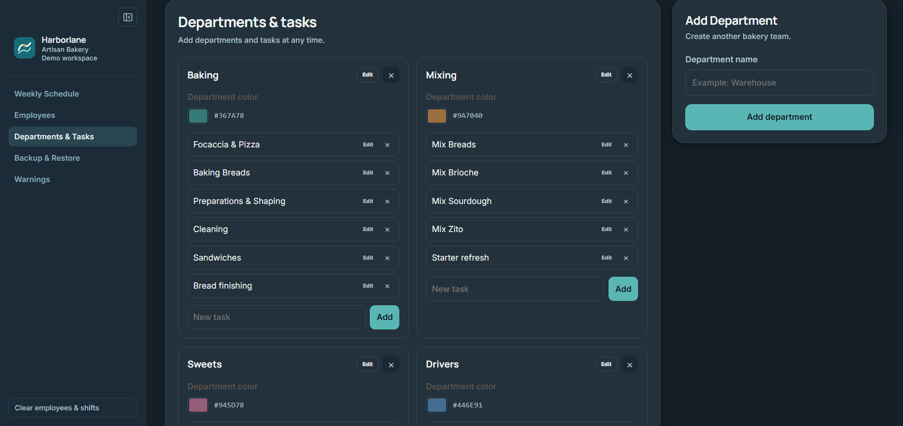
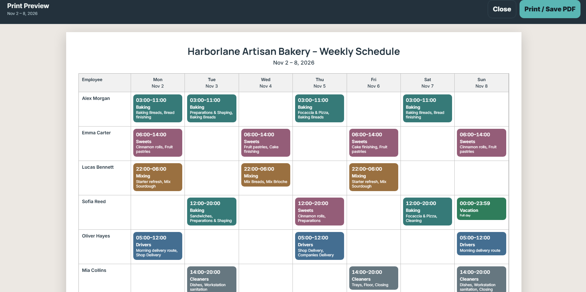

# Shift Planner

A React application for planning a small team's weekly schedule. The portfolio demo uses **Harborlane Artisan Bakery**, a fictional business, and invented employees and work assignments.

## Screenshots

### Weekly grid

Light and dark appearances of the Monday-Sunday schedule:





### List view





### Add and edit entries



### Employees



### Departments and tasks



### Print preview



## Features

- Monday-Sunday Grid and List views, week navigation, and a date picker.
- Horizontally scrollable grid with pinned employee details and weekly working-hour totals.
- One responsive Add/Edit drawer for shifts, vacation, and unavailability, with validation, Escape/Cancel handling, and unsaved-change confirmation.
- Employee management with multiple department assignments and duplicate-name checks.
- Department and task management, custom department colors, and tasks selected from multiple departments.
- Conflict detection for the same employee, including overnight entries and Sunday-to-Monday overlaps across weeks; a separate warnings view.
- Light, Dark, and System themes, plus a collapsible desktop sidebar.
- Local saving in browser localStorage. Unreadable JSON or invalid outer data shapes are protected from automatic overwrite, with visible load/save warnings.
- JSON backup export and restore, with replace and merge modes.
- A4 landscape print preview and printing or Save as PDF through the browser.

The app has no backend or account system. Data stays in the current browser profile; export a backup before clearing browser data or moving to another device. Merge uses existing ID/name matching rules and is not a synchronization service.

## Technology

React 19 and React DOM, JavaScript, Vite 8, and CSS. Development tooling includes the Vite React plugin and Oxlint. Regression tests use Node's built-in test runner; no separate test framework is installed.

Manrope and Inter are loaded through Google Fonts, with system font fallbacks when unavailable.

## Run locally

Use Node.js **20.19+ in the 20.x series, or 22.12+**, matching the installed Vite package's engine requirement, and npm.

From your local clone of this repository:

```sh
npm ci
npm run dev
```

Open the local URL printed by Vite. On Windows PowerShell, use `npm.cmd` if script execution policy prevents running `npm`.

## Fictional demo data

[Download the demo backup](demo/harborlane-demo.json) for November 2-8, 2026. It contains six fictional employees, five departments, 20 working shifts (including three overnight shifts), and one vacation entry.

1. Open the app in a separate, empty browser profile.
2. Go to **Backup & restore**, choose **Import and replace**, and select `demo/harborlane-demo.json`.
3. Confirm replacement in that isolated profile, then select the week beginning **November 2, 2026**.

**Import and replace overwrites that profile's current planner data.** Do not load the demo over a real schedule. The demo does not load automatically.

Harborlane Artisan Bakery, the demonstration employees, and their schedules are fictional and do not represent a real employer or workforce.

## Verification

Run the existing regression suite, lint, and production build:

```sh
node --test src/lib/*.test.js
npm run lint
npm run build
```

The current suite has **57 passing tests** covering date/time calculations, overnight conflicts, hour totals, storage guards, duplicate names, editor form preparation/change detection, badge contrast choices, avatars, and theme utilities. These are utility tests, not browser interaction tests. Lint currently reports two unused-variable warnings in `src/App.jsx`: `selectedDepartment` and `getEmployee`.

To serve the production build locally:

```sh
npm run preview
```

For browser checks, review both schedule views and themes at desktop and mobile widths, exercise Add/Edit/Delete and drawer keyboard behavior using disposable demo data, and inspect Print Preview and a saved PDF. Real printer output and pagination depend on the browser and print settings.
